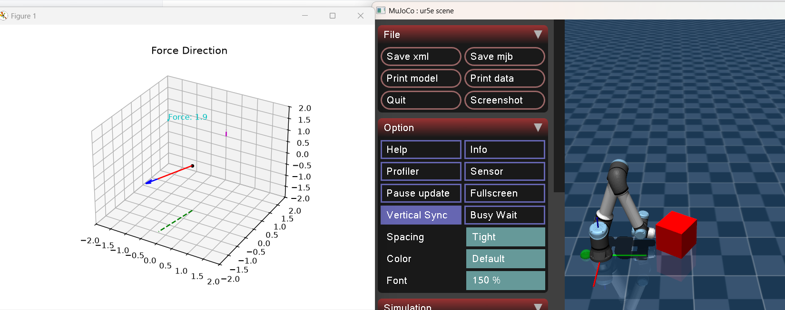
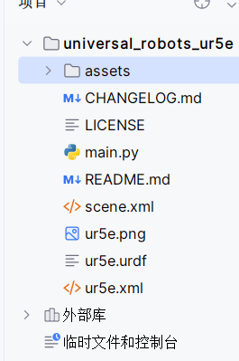
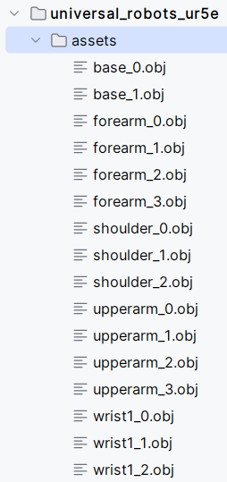
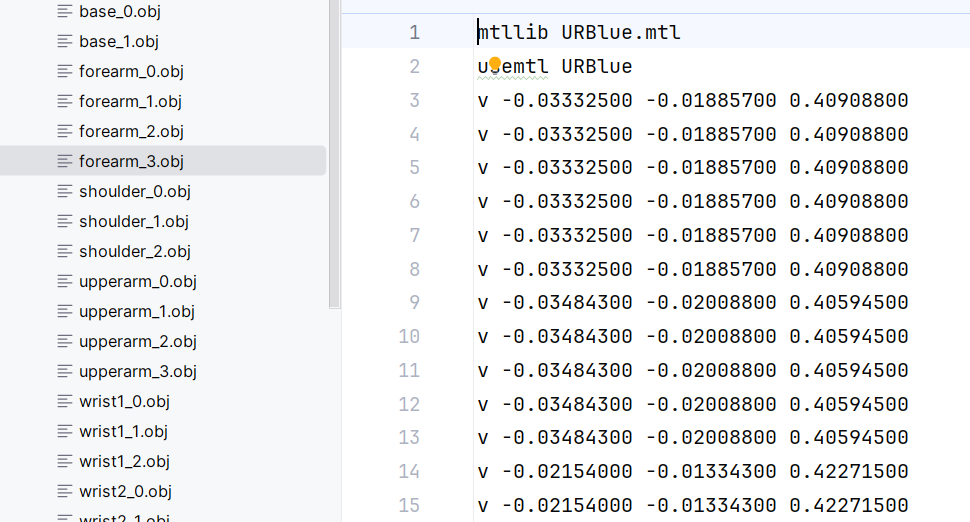

# 第一天mujoco仿真平台

复现了https://blog.csdn.net/Vint_LU/article/details/147948556 这个项目，这个项目是挺简单的大概一个小时内就可以复现，主要是理解整个mujoco的框架以及读懂代码。



## 文件夹内容



### assets

“assets”存储网格文件，存储的是机器人各连杆的外形网格，这些obj里面都是三维的坐标



### scene.xml

将机器人信息与环境信息结合，在此项目中机器人信息存储在“ur5e.xml”中,以下是代码内容：

``` xml
<mujoco model="ur5e scene">  # MuJoCo 模型的根标签
  <include file="ur5e.xml"/>  # 引入机器人文件，换机器人只需要修改这个导入路径

  <visual>  # 渲染部分的内容
    <headlight diffuse="0.6 0.6 0.6" ambient="0.1 0.1 0.1" specular="0 0 0"/>  #头灯（相机自带光源）的三个分量：diffuse漫反射强度、ambient环境光、specular高光
    <rgba haze="0.15 0.25 0.35 1"/> # 雾 前三位是RGB这个系数×255就是对应的数值，1是透明度取值在0~1之间，1代表完全不透明
    <global azimuth="120" elevation="-20"/> # 默认自由相机的视角：方位角 120°、俯仰 -20°（略微俯视）。改了这行，每次打开窗口的初始视角就变了。
  </visual>

  <asset> # 定义后面仿真中要用到的资源，纹理、材质、网格模型、字体等
    <texture type="skybox" builtin="gradient" rgb1="0.3 0.5 0.7" rgb2="0 0 0" width="512" height="3072"/>
      # 天空的纹理，渐变背景，上面的颜色、下边的颜色，高宽大小
    <texture type="2d" name="groundplane" builtin="checker" mark="edge" rgb1="0.2 0.3 0.4" rgb2="0.1 0.2 0.3"
      markrgb="0.8 0.8 0.8" width="300" height="300"/>
      # 地面的纹理，2d，棋盘格，棋盘格加边框，棋盘格两种颜色，边框颜色，地面大小
    <material name="groundplane" texture="groundplane" texuniform="true" texrepeat="5 5" reflectance="0.2"/>
      # 地面的材质，纹理均匀缩放让物体运动时格子不动，纹理在 uv 方向重复 5 次，反光强度0~1
  </asset>

      <worldbody> # 场景实体
        <light pos="0 0 1.5" dir="0 0 -1" directional="true"/> # 光源 位置离地面1.5m 照射方向沿着Z轴往下 平行光
        <geom name="floor" size="0 0 0.05" type="plane" material="groundplane"/> # 地面 大小00代表默认值0.05代表渲染网格线的间距，类型是无限大的平面，材质为定义过的

        <body name="world_frame" pos="0 0 0"> # 坐标轴指示器，随时能看出世界坐标系的方向和原点在哪
            <geom name="X" type="cylinder" size="0.005" fromto="0 0 0 0.3 0 0" rgba="1 0 0 1" contype="0"
                  conaffinity="0"/>
            <geom name="Y" type="cylinder" size="0.005" fromto="0 0 0 0 0.3 0" rgba="0 1 0 1" contype="0"
                  conaffinity="0"/>
            <geom name="Z" type="cylinder" size="0.005" fromto="0 0 0 0 0 0.3" rgba="0 0 1 1" contype="0"
                  conaffinity="0"/>
            # xyz三个方向 圆柱体 半径5mm 圆柱中心线段 颜色 不与任何东西碰撞 不响应任何碰撞
        </body>
        <body name="red_box" pos="-0.1 0.5 0.1" euler="0 0 45"> # 定义一个红盒子 中心位置 绕z轴转45度
            <joint name="red_box_joint" type="free"/> # 自由关节 6个自由度
            <geom name="red_box_geom" type="box" size="0.1 0.1 0.1" rgba="1 0 0 1" mass="1.0"/> 
            # 红盒子的几何 box 大小 颜色 质量
        </body>

        <body name="target" pos="-0.13 0.5 0.1"> # 定义一个目标 位置
            <geom size="0.02" rgba="0 1 0 0.5" contype="0" conaffinity="0"/> 
            # 几何球（没写type默认就是sphere球） 半径0.02m 颜色 纯标记，不与机械臂碰撞
        </body>

    </worldbody>
</mujoco>

```

这个文件夹定义了环境和环境中的物体，也就是搭建一个可供仿真的世界，并把机器人装进去，接下来看机器人本体

## ur5e.xml

`default` 定义了六种 "模板"（通用关节、大执行器、大执行器限位版、小执行器、视觉体、碰撞体），`worldbody` 里的七层 body 只负责**填位置和引用模板**，`actuator` 只负责**绑关节**，`sensor` 只负责**绑 site**。

```xml
<mujoco model="ur5e">  # 模型的根标签
  <compiler angle="radian" meshdir="assets" autolimits="true"/> # 角度全部按照弧度来计算 网格加载

  <option integrator="implicitfast"/> # 积分器

  <default> # 按元素类型分组的属性模板（参数类）
    <default class="ur5e"> # 整条关节臂通用
      <material specular="0.5" shininess="0.25"/> # 材质 高光 锐度
      <joint axis="0 1 0" range="-6.28319 6.28319" armature="0.1"/> # 关节 绕y轴 可旋转360° 关节转子的等效惯量
      <general gaintype="fixed" biastype="affine" ctrlrange="-6.2831 6.2831" gainprm="2000" biasprm="0 -2000 -400"
        forcerange="-150 150"/> # 执行器模板 force = gain × ctrl + bias 其中 gain = gainprm[0] bias = biasprm[0] + biasprm[1]×qpos + biasprm[2]×qvel

      <default class="size3">  # 派生类 size是命名空间无意义
        <default class="size3_limited"> # size3_limited`在size3之下继承全部父类参数，再额外收紧限位到 ±180
          <joint range="-3.1415 3.1415"/>
          <general ctrlrange="-3.1415 3.1415"/>
        </default>
      </default>
      <default class="size1"> # size1
        <general gainprm="500" biasprm="0 -500 -100" forcerange="-28 28"/>
        # 腕部三个关节用小增益：`kp=500`、`kd=100`、力矩上限 ±28 N・m。
      </default>
      <default class="visual"> # 视觉 / 碰撞 / 标记
        <geom type="mesh" contype="0" conaffinity="0" group="2"/> 网格 不碰撞 不响应碰撞
      </default>
      <default class="collision"> # 碰撞
        <geom type="capsule" group="3"/> # 几何 胶囊体 渲染分组展示开关
        <default class="eef_collision"> # 标记
          <geom type="cylinder"/> # 圆柱
        </default>
      </default>
      <site size="0.001" rgba="0.5 0.5 0.5 0.3" group="4"/> # 传感器尺寸 颜色
    </default>
  </default>

  <asset> # 资源库
    <material class="ur5e" name="black" rgba="0.033 0.033 0.033 1"/>
    <material class="ur5e" name="jointgray" rgba="0.278 0.278 0.278 1"/>
    <material class="ur5e" name="linkgray" rgba="0.82 0.82 0.82 1"/>
    <material class="ur5e" name="urblue" rgba="0.49 0.678 0.8 1"/>

    <mesh file="base_0.obj"/>
    <mesh file="base_1.obj"/>
    <mesh file="shoulder_0.obj"/>
    <mesh file="shoulder_1.obj"/>
    <mesh file="shoulder_2.obj"/>
    <mesh file="upperarm_0.obj"/>
    <mesh file="upperarm_1.obj"/>
    <mesh file="upperarm_2.obj"/>
    <mesh file="upperarm_3.obj"/>
    <mesh file="forearm_0.obj"/>
    <mesh file="forearm_1.obj"/>
    <mesh file="forearm_2.obj"/>
    <mesh file="forearm_3.obj"/>
    <mesh file="wrist1_0.obj"/>
    <mesh file="wrist1_1.obj"/>
    <mesh file="wrist1_2.obj"/>
    <mesh file="wrist2_0.obj"/>
    <mesh file="wrist2_1.obj"/>
    <mesh file="wrist2_2.obj"/>
    <mesh file="wrist3.obj"/>
  </asset>

  <worldbody>
    <body name="base" quat="0 0 0 -1" childclass="ur5e">
      # 根刚体。quat="0 0 0 -1" 是 (w,x,y,z) → 绕 z 转 180° childclass：所有后代自动继承 class="ur5e" 的模板
      <inertial mass="4.0" pos="0 0 0" diaginertia="0.00443333156 0.00443333156 0.0072"/>
      # 质量 中心位置 主轴惯量
      <geom mesh="base_0" material="black" class="visual"/>
      # 网格 材质 继承类别来自visual
      <geom mesh="base_1" material="jointgray" class="visual"/>
      # 网格 材质 继承类别来自visual
      <body name="shoulder_link" pos="0 0 0.163">
        # 肩部：绕 z 轴旋转（水平转动整条手臂）位置
        <inertial mass="3.7" pos="0 0 0" diaginertia="0.0102675 0.0102675 0.00666"/>
        质量 质心在自身原点 主轴惯量
        <joint name="shoulder_pan_joint" class="size3" axis="0 0 1"/>
        # 关节
        <geom mesh="shoulder_0" material="urblue" class="visual"/>
        <geom mesh="shoulder_1" material="black" class="visual"/>
        <geom mesh="shoulder_2" material="jointgray" class="visual"/>
        <geom class="collision" size="0.06 0.06" pos="0 0 -0.04"/>
        # 大臂：quat 绕 y 转 180°，让默认 y 轴方向正确
        <body name="upper_arm_link" pos="0 0.138 0" quat="1 0 1 0">
          <inertial mass="8.393" pos="0 0 0.2125" diaginertia="0.133886 0.133886 0.0151074"/>

          <joint name="shoulder_lift_joint" class="size3"/>
          <geom mesh="upperarm_0" material="linkgray" class="visual"/>
          <geom mesh="upperarm_1" material="black" class="visual"/>
          <geom mesh="upperarm_2" material="jointgray" class="visual"/>
          <geom mesh="upperarm_3" material="urblue" class="visual"/>
          <geom class="collision" pos="0 -0.04 0" quat="1 1 0 0" size="0.06 0.06"/>
          <geom class="collision" size="0.05 0.2" pos="0 0 0.2"/>
          # 小臂
          <body name="forearm_link" pos="0 -0.131 0.425">
            <inertial mass="2.275" pos="0 0 0.196" diaginertia="0.0311796 0.0311796 0.004095"/>
            <joint name="elbow_joint" class="size3_limited"/>
            <geom mesh="forearm_0" material="urblue" class="visual"/>
            <geom mesh="forearm_1" material="linkgray" class="visual"/>
            <geom mesh="forearm_2" material="black" class="visual"/>
            <geom mesh="forearm_3" material="jointgray" class="visual"/>
            <geom class="collision" pos="0 0.08 0" quat="1 1 0 0" size="0.055 0.06"/>
            <geom class="collision" size="0.038 0.19" pos="0 0 0.2"/>
            # 腕 1（y 轴）
            <body name="wrist_1_link" pos="0 0 0.392" quat="1 0 1 0">
              <inertial mass="1.219" pos="0 0.127 0" diaginertia="0.0025599 0.0025599 0.0021942"/>
              <joint name="wrist_1_joint" class="size1"/>
              <geom mesh="wrist1_0" material="black" class="visual"/>
              <geom mesh="wrist1_1" material="urblue" class="visual"/>
              <geom mesh="wrist1_2" material="jointgray" class="visual"/>
              <geom class="collision" pos="0 0.05 0" quat="1 1 0 0" size="0.04 0.07"/>
              # 腕2 z轴
              <body name="wrist_2_link" pos="0 0.127 0">
                <inertial mass="1.219" pos="0 0 0.1" diaginertia="0.0025599 0.0025599 0.0021942"/>
                <joint name="wrist_2_joint" axis="0 0 1" class="size1"/>
                <geom mesh="wrist2_0" material="black" class="visual"/>
                <geom mesh="wrist2_1" material="urblue" class="visual"/>
                <geom mesh="wrist2_2" material="jointgray" class="visual"/>
                <geom class="collision" size="0.04 0.06" pos="0 0 0.04"/>
                <geom class="collision" pos="0 0.02 0.1" quat="1 1 0 0" size="0.04 0.04"/>
                # 腕3y轴
                <body name="wrist_3_link" pos="0 0 0.1">
                  <inertial mass="0.1889" pos="0 0.0771683 0" quat="1 0 0 1"
                    diaginertia="0.000132134 9.90863e-05 9.90863e-05"/>
                  <joint name="wrist_3_joint" class="size1"/>
                  <geom material="linkgray" mesh="wrist3" class="visual"/>
                  <geom class="eef_collision" pos="0 0.08 0" quat="1 1 0 0" size="0.04 0.02"/>
                  # 末端推头：圆柱，半径 0.04、半长 0.02，沿 y 前伸 8 cm。
                       quat="1 1 0 0" 是绕 x 转 180°，把圆柱轴向从 z 转到 y。
                       真正接触方块的就是这个几何体
                  <site name="attachment_site" pos="0 0.1 0" quat="-1 1 0 0"/>
                  # 力传感器锚点：腕3 前方 10 cm。
                       quat="-1 1 0 0" 是绕 x 转 180°，所以 site 的 z 轴指向工具内侧，
                       这就是 sensordata 里 z 分量出现负值的原因
                </body>
              </body>
            </body>
          </body>
        </body>
      </body>
      <body name="force_sensor" pos="0 0.1 0" euler="3.14 0 3.14"> # 传感器
        <geom name='force_sensor_geom' type="sphere" mass="0.0" size="0.04" rgba="0 1 0 0.3"/>
        <site name="force_sensor_site" pos="0 0 0" quat="1 0 0 0"/>
      </body>

    </body>
  </worldbody>
  <sensor>
        <force name="tool_force" site="attachment_site"/>
  </sensor>
  <actuator> # 执行器 模板 + 名字 + 绑哪个关节
    <general class="size3" name="shoulder_pan" joint="shoulder_pan_joint"/>
    <general class="size3" name="shoulder_lift" joint="shoulder_lift_joint"/>
    <general class="size3_limited" name="elbow" joint="elbow_joint"/>
    <general class="size1" name="wrist_1" joint="wrist_1_joint"/>
    <general class="size1" name="wrist_2" joint="wrist_2_joint"/>
    <general class="size1" name="wrist_3" joint="wrist_3_joint"/>
  </actuator>

<!--  <keyframe>-->
<!--    <key name="home" qpos="-1.5708 -1.5708 1.5708 -1.5708 -1.5708 0" ctrl="-1.5708 -1.5708 1.5708 -1.5708 -1.5708 0"/>-->
<!--  </keyframe>-->
</mujoco>

```

## ur5e.urdf

与ur5e.xml描述同一个UR5e，但是格式坐标系用途都不同

|          | `ur5e.xml`（MJCF）                 | `ur5e.urdf`（URDF）                            |
| -------- | ---------------------------------- | ---------------------------------------------- |
| 谁读     | MuJoCo                             | **ikpy**                                       |
| 提供什么 | 质量、惯量、碰撞体、执行器、传感器 | **纯关节链**：谁接谁、相对偏移多少、绕哪个轴转 |
| 坐标系   | 世界系（base 转了 180°）           | `base_link` 系                                 |
| 含网格   | 引用 `assets/*.obj`                | 只写路径，**ikpy 根本不读**                    |
| 含惯量   | 参与动力学                         | 写了但被忽略                                   |

ikpy将内容读取成链

```xml
chain = ikpy.chain.Chain.from_urdf_file("ur5e.urdf", base="base_link", tip="tool0")
```

ikpy 的 `URDF.get_urdf_parameters` 做三件事：

1. 从 `base` link 往下找路径，直到 `tip`；

2. 路径上每个 `<joint>` 变成 ikpy 的一个 `Link` 对象（内部存着 origin 变换 + 旋转轴）；

3. 遇到 `type="fixed"` 的关节，也建 `Link`，但标记为**固定**（不参与优化）。

   | 问题                                                   | 根因                                                         |
   | ------------------------------------------------------ | ------------------------------------------------------------ |
   | `ValueError: Several links end the tree below 'world'` | URDF 有**多个叶子**（`ee_link`、`tool0`、`base`），ikpy 不知道哪条是链的终点 → 必须显式给 `tip="tool0"` |
   | `'tool0' is not below 'base'`                          | `base` 是个**叶子节点**（base_link 的子、无后代），链不可能从它出发 → 必须用 `base="base_link"` |
   | 末端算出来是 `(0.13, -0.5)`，目标却是 `(-0.13, 0.5)`   | URDF 系与 MJCF 世界系差 180°，靠 `global_transform` 或 `diag(-1,-1,1)` 补 |

## main

**读状态（qpos）→ 定目标（ctrl）→ 读传感器 → 画图 → 推一步物理 → 刷一帧画面**，循环往复

```python
import mujoco.viewer
import ikpy.chain
import transforms3d as tf
import numpy as np
from collections import deque
import matplotlib.pyplot as plt


def viewer_init(viewer):
    """渲染器的摄像头视角初始化"""
    viewer.cam.type = mujoco.mjtCamera.mjCAMERA_FREE
    viewer.cam.lookat[:] = [0, 0.5, 0.5]
    viewer.cam.distance = 2.5
    viewer.cam.azimuth = 180
    viewer.cam.elevation = -30
    # `mjCAMERA_FREE`自由相机（可鼠标拖动），而非绑在某个 body 上`lookat = [0, 0.5, 0.5]`**相机注视点**（世界坐标）。y=0.5 正对工位前方，z=0.5 是手臂高度`distance = 2.5`相机到注视点的距离（米）`azimuth = 180`绕垂直轴转 180°，从 “背后” 看`elevation = -30`俯视 30°

class ForcePlotter:
    """实时可视化接触力，20帧更新一次"""

    def __init__(self, update_interval=20):
        plt.ion()
        self.fig = plt.figure()
        self.ax = self.fig.add_subplot(111, projection='3d')
        self.update_interval = update_interval  # 更新间隔帧数
        self.frame_count = 0  # 帧计数器

    def plot_force_vector(self, force_vector):
        self.frame_count += 1
        if self.frame_count % self.update_interval != 0:
            return  # 跳过本次渲染

        self.ax.clear()

        origin = np.array([0, 0, 0])
        force_magnitude = np.linalg.norm(force_vector)
        force_direction = force_vector / force_magnitude if force_magnitude > 1e-6 else np.zeros(3)

        # 主箭头
        arrow_tip = force_direction * 1.5
        self.ax.quiver(*origin, *arrow_tip, color='r', arrow_length_ratio=0)

        # 蓝色箭头
        self.ax.quiver(*arrow_tip, *(0.5 * force_direction), color='b', arrow_length_ratio=0.5)

        # XY平面投影
        self.ax.plot([0, arrow_tip[0]], [0, arrow_tip[1]], [-2, -2], 'g--')

        # XZ平面投影
        self.ax.plot([0, 0], [2, 2], [0, arrow_tip[2]], 'm--')

        # 力大小指示条
        scaled_force = min(max(force_magnitude / 50, 0), 2)
        self.ax.plot([-2, -2], [2, 2], [0, scaled_force], 'c-')
        self.ax.text(-2, 2, scaled_force, f'Force: {force_magnitude:.1f}', color='c')

        # 坐标系设置
        self.ax.scatter(0, 0, 0, color='k', s=10)
        self.ax.set_xlim([-2, 2])
        self.ax.set_ylim([-2, 2])
        self.ax.set_zlim([-2, 2])
        self.ax.set_title(f'Force Direction')

        plt.draw()
        plt.pause(0.001)
        self.frame_count = 0  # 重置计数器


class ForceSensor:
    def __init__(self, model, data, window_size=100):
        self.model = model
        self.data = data
        self.window_size = window_size
        self.force_history = deque(maxlen=window_size)

    def filter(self):
        """获取并滑动平均滤波力传感器数据(传感器坐标系下)"""
        # 获取MjData中的传感器数据
        force_local_raw = self.data.sensordata[:3].copy() * -1
        #sensordata[:3]硬编码取前 3 个数（依赖 arange：adr=0、dim=3）.copy()避免引用被下一步覆盖* -1符号取反：传感器报 “作用在工具上的力”，取反后变成 “工具施加给物体的力”，即推动方向

        # 添加新数据到滑动窗口
        self.force_history.append(force_local_raw)

        # 计算滑动平均
        filtered_force = np.mean(self.force_history, axis=0)

        return filtered_force


class JointSpaceTrajectory:
    """关节空间坐标系下的线性插值轨迹"""

    def __init__(self, start_joints, end_joints, steps):
        self.start_joints = np.array(start_joints)
        self.end_joints = np.array(end_joints)
        self.steps = steps
        self.step = (self.end_joints - self.start_joints) / self.steps
        self.trajectory = self._generate_trajectory()
        self.waypoint = self.start_joints

    def _generate_trajectory(self):
        for i in range(self.steps + 1):
            yield self.start_joints + self.step * i
        # 确保最后精确到达目标关节值
        yield self.end_joints

    def get_next_waypoint(self, qpos):
        # 检查当前的关节值是否已经接近目标路径点。若是，则更新下一个目标路径点；若否，则保持当前目标路径点不变。
        if np.allclose(qpos, self.waypoint, atol=0.02):
            try:
                self.waypoint = next(self.trajectory)
                return self.waypoint
            except StopIteration:
                pass
        return self.waypoint


def main():
    model = mujoco.MjModel.from_xml_path('scene.xml')
    data = mujoco.MjData(model)
    my_chain = ikpy.chain.Chain.from_urdf_file("ur5e.urdf",
                                               base="base_link",
                                               tip="tool0",
                                               active_links_mask=[False, False] + [True] * 6 + [False])

    start_joints = np.array([-1.57, -1.34, 2.65, -1.3, 1.55, 0])  # 对应机械臂初始位姿[-0.13, 0.3, 0.1, 3.14, 0, 1.57]
    data.qpos[:6] = start_joints  # 确保渲染一开始机械臂便处于起始位置，而非MJCF中的默认位置

    # 设置目标点
    ee_pos = [-0.13, 0.6, 0.1]
    ee_euler = [3.14, 0, 1.57]
    ref_pos = [0, 0, -1.57, -1.34, 2.65, -1.3, 1.55, 0, 0]
    ee_orientation = tf.euler.euler2mat(*ee_euler)
    #ee_pos末端目标位置。注意 y=0.6，而 scene.xml 里 target 球在 y=0.5 ee_euler目标姿态，弧度。euler2mat默认按 sxyz 顺序转成 3×3 矩阵ref_pos9 个数的 IK 初值，对应 9 个 link。初值决定收敛到哪个解分支

    joint_angles = my_chain.inverse_kinematics(ee_pos, ee_orientation, "all", initial_position=ref_pos)
    end_joints = joint_angles[2:-1]

    joint_trajectory = JointSpaceTrajectory(start_joints, end_joints, steps=100)

    force_sensor = ForceSensor(model, data)
    force_plotter = ForcePlotter()

    with mujoco.viewer.launch_passive(model, data) as viewer:
        viewer_init(viewer)
        while viewer.is_running():
            waypoint = joint_trajectory.get_next_waypoint(data.qpos[:6])
            data.ctrl[:6] = waypoint

            filtered_force = force_sensor.filter()
            force_plotter.plot_force_vector(filtered_force)

            mujoco.mj_step(model, data)
            viewer.sync()
            # 仿真不断循环 更新模型和数据并可视化
        print("接触点数 ncon:", data.ncon)
        for i in range(data.ncon):
            f6 = np.zeros(6)
            mujoco.mj_contactForce(model, data, i, f6)
            print(i, "geom", data.contact[i].geom1, data.contact[i].geom2,
                  "dist", round(data.contact[i].dist, 5), "force", np.round(f6[:3], 4))
        print("传感器数量 nsensor:", model.nsensor)
        for i in range(model.nsensor):
            print(i, mujoco.mj_id2name(model, mujoco.mjtObj.mjOBJ_SENSOR, i),
                  "type", model.sensor_type[i],  # mjSENS_FORCE 之类
                  "dim", model.sensor_dim[i],
                  "adr", model.sensor_adr[i])

        print("sensordata:", np.round(data.sensordata, 4))


if __name__ == "__main__":
    main()
```


描述yu